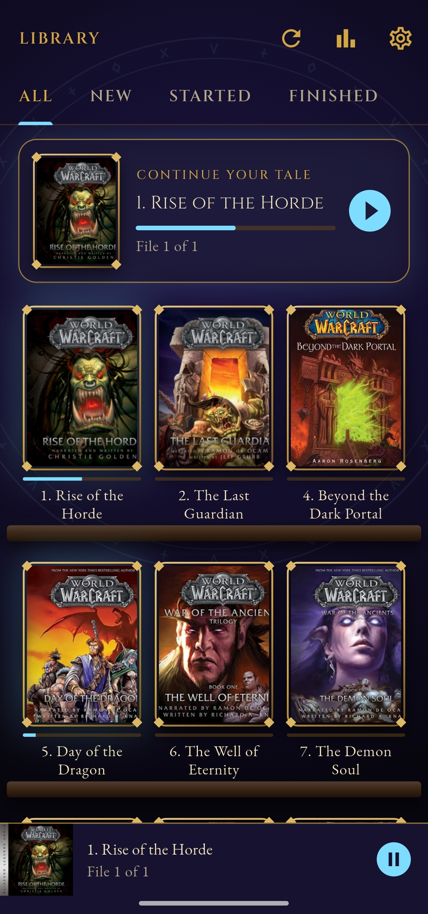
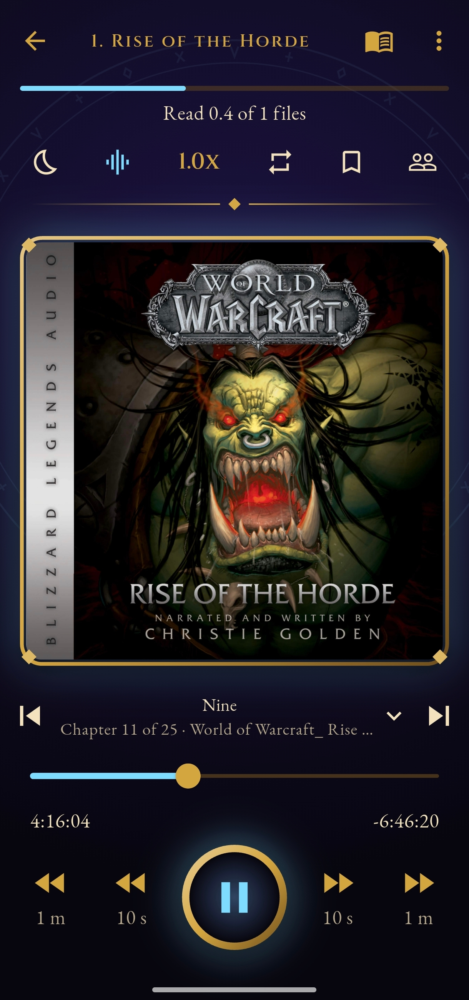
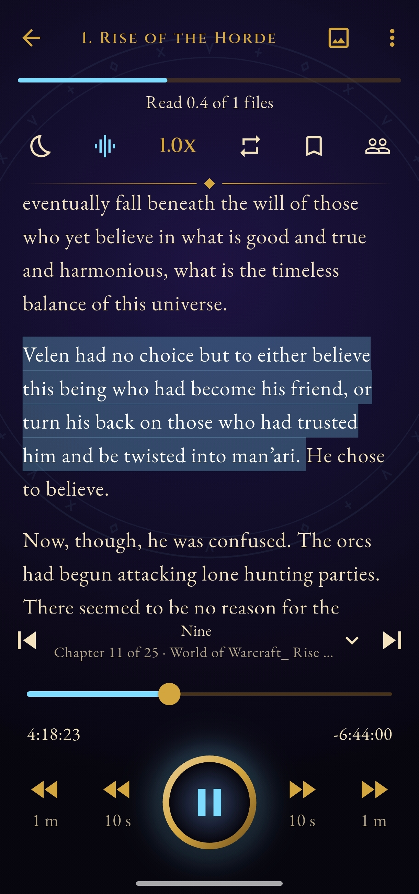
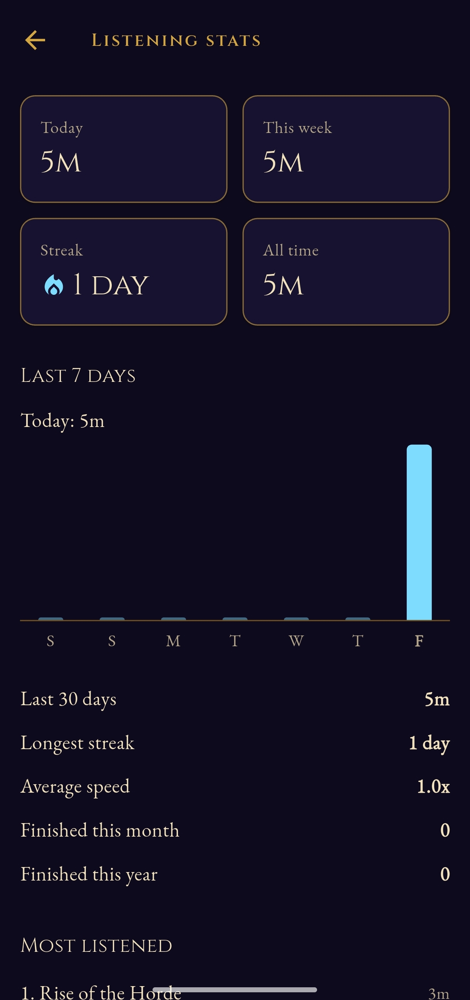

<p align="center">
  
</p>

<h1 align="center">Tomecast</h1>

<p align="center">
  A free, offline audiobook player for Android, with read-along text that syncs on your phone.
</p>

<p align="center">
  <a href="https://github.com/BrylleJacobGeslaga-UCM/Tomecast/releases/latest"><b>⬇ Download the latest APK</b></a>
</p>

---

## Screenshots

| Library | Player | Read-along | Stats |
|---|---|---|---|
|  |  |  |  |

## Features

**Library**
- Pick a folder: every subfolder becomes a book (covers from `cover.jpg` / `folder.jpg`)
- All / New / Started / Finished tabs, mark finished, reset progress
- Find covers online (Open Library)
- Home screen widget with play/pause and skip buttons

**Player**
- Remembers your place in every book, with per-book speed (0.5x–3.0x)
- Skip ±10 s / ±1 min (adjustable), seek bar, file list
- Chapters inside `.m4b` / `.m4a` files and from `.cue` sheets
- Position shown as files, hours or percent (tap to switch)
- Background playback, lock-screen and notification controls, headset buttons
- Smart rewind after a pause
- A-B repeat
- Skip intro / outro of every file (per book)
- Volume boost, equalizer, pitch, skip silence
- Bookmarks with notes, and a character list per book
- Flip the phone face down to pause
- Auto-play the next book

**Sleep timer**
- 5–90 minutes or "end of file", fades out at the end
- Shake the phone to reset it, or to keep listening right after it stops

**Read-along text**
- **Live sync:** add the EPUB of any audiobook and Tomecast matches the text to the narration on your phone (offline speech recognition with Whisper), a few minutes ahead of where you are
- **Storyteller books:** EPUB 3 files with synced narration play with full text highlighting
- **Subtitles:** `.srt` files next to the audio
- The current sentence stays highlighted and centered; tap any sentence to jump there

**Listening stats**
- Today, this week, streaks, last 7 days chart, most listened, books finished

## How to organize your audiobooks

```
Audiobooks/
└── Warcraft/                      ← pick this folder in Tomecast
    ├── 1. Rise of the Horde/
    │   ├── cover.jpg
    │   ├── 01 - Rise of the Horde.m4b
    │   └── 02 - Rise of the Horde.m4b
    └── 5. Day of the Dragon/
        ├── cover.jpg
        ├── Day of the Dragon.cue  ← optional chapters
        └── 01 - Day of the Dragon.mp3
```

## Install

1. Download the APK for your phone from [Releases](https://github.com/BrylleJacobGeslaga-UCM/Tomecast/releases/latest)
   (most phones: `app-arm64-v8a-release.apk`).
2. Open it and allow installing from this source.
3. Pick your audiobook folder and allow **All files access** (needed to read your audio files).

Requires Android 7.0 or newer. The speech model for live read-along (about 140 MB) is downloaded the first time you use it; everything else works offline.

## Build it yourself

```bash
git clone https://github.com/BrylleJacobGeslaga-UCM/Tomecast.git
cd Tomecast
flutter pub get
flutter run
```

Needs the Flutter SDK, Android SDK 37 and the Android NDK (for Whisper).

## Built with

- [Flutter](https://flutter.dev)
- [just_audio](https://pub.dev/packages/just_audio) and [audio_service](https://pub.dev/packages/audio_service) for playback
- [whisper_kit](https://pub.dev/packages/whisper_kit) ([whisper.cpp](https://github.com/ggerganov/whisper.cpp)) for on-device speech recognition
- [home_widget](https://pub.dev/packages/home_widget) for the home screen widget
- [Storyteller](https://storyteller-platform.gitlab.io/storyteller/) for ready-made synced EPUBs
- Covers from [Open Library](https://openlibrary.org)

Tomecast plays files you already own. It does not download audiobooks and cannot open DRM-protected books.

## License

MIT
